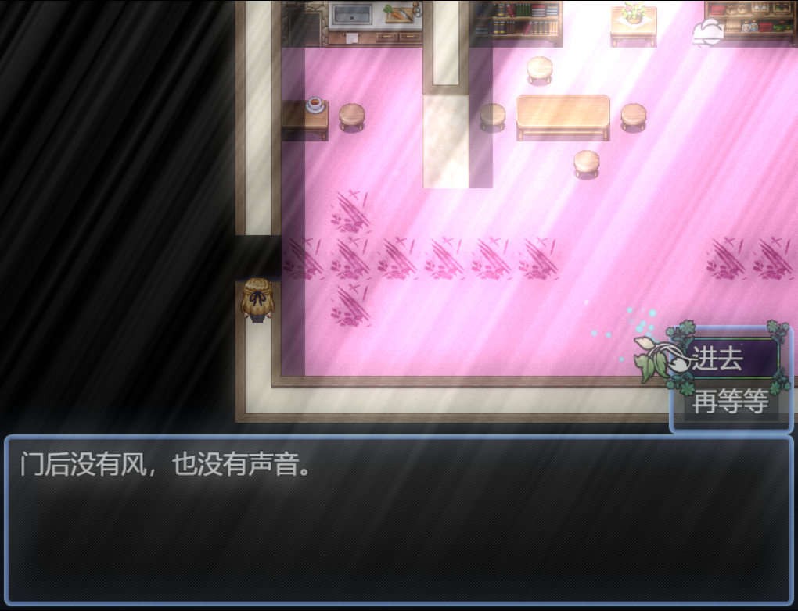
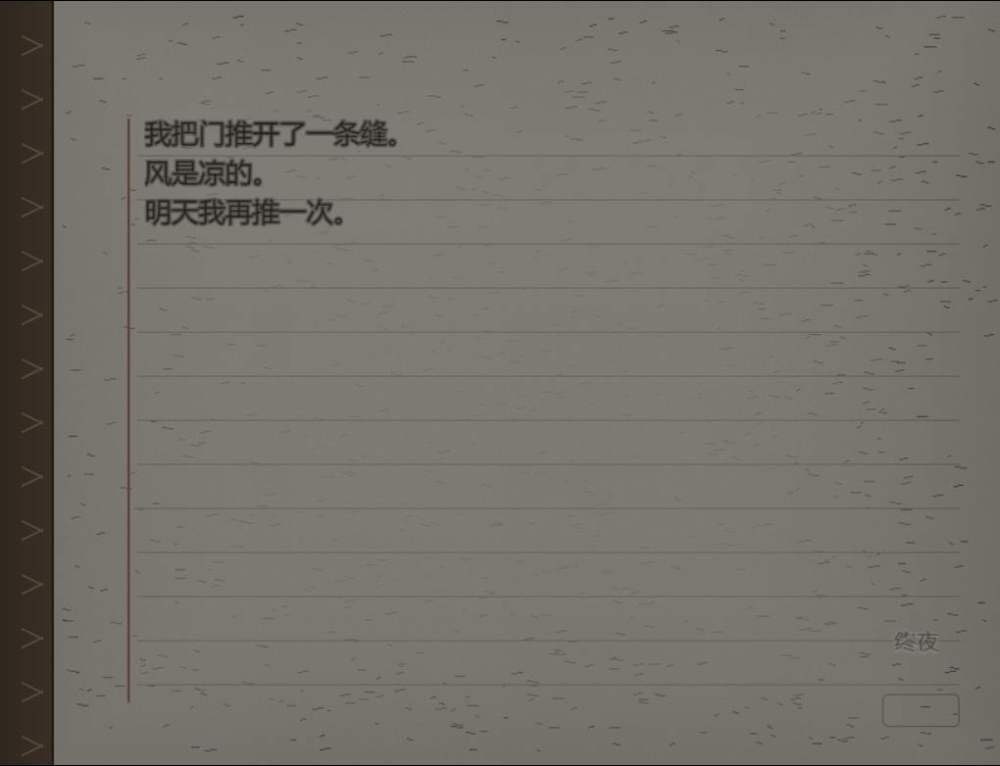

# 批次 6：终章档位与交互修复报告

> 日期：2026-10-19 ｜ 阶段：发布候选 QA ｜ 结论：**通过**
>
> 本轮只处理发布候选阶段剩下的两件事：修掉批次 5 已知的 Map021 重复传送询问，并把结局档位 2、3 各自从推门跑到制作名单与标题。档位 1 已在批次 5 实跑，本轮不重复。

---

## 1. 结论摘要

| 项目 | 结果 |
|---|---|
| Map021 墙体 2 选「再等等」 | 事件正常结束，**不再重复弹窗**，玩家留在原地 |
| Map021 墙体 2 选「进去」 | 正常传送到 Map019 (21, 22) |
| 结局档位 2（V18≥5） | **PASS 34/34**，第 5 夜变体 2，V27=2 |
| 结局档位 3（其余情况） | **PASS 24/24**，第 5 夜变体 3，V27=3 |
| 尾声 | 两档均进入 Map036 (8, 18)，尾声图 `尾声_醒来` 正常显示 |
| 制作名单 | 滚动到结尾，「谢谢你陪她走到这里。」与作者署名均可见 |
| 回标题 | 两档均回到 Scene_Title，S37 已打开 |
| 测试插件清理 | 已删除；`plugins.js` 恢复为 **29 个发布插件** |

本轮是**定点发布候选验收**，不是批次 5 那种 206 项全流程回归。验证边界见 §6，结论不应外推为「所有章节已重新逐格实走」。

---

## 2. Map021 重复传送询问：根因与修复

### 根因

Map021 的「墙体 2」事件（事件 ID 3，坐标 5,17）第二页同时满足两个条件：

- 自开关 A 已打开（第一面墙砸开后写入）
- 开关 S10 已打开（剧情推进）

该页原来的触发方式是 `3`（自动执行）。玩家选「否」后事件结束，但人仍站在事件格上，自动执行页立刻再次启动，于是反复弹出「是否进行传送」。第一页是确认键触发，所以没有这个问题。

### 修复

文件：[Map021.json](../../工程/data/Map021.json)  
备份：`工程/data/Map021.json.bak_before_teleport_fix`

第二页改为确认键触发，并补一句氛围文本与更清楚的双选项：

```text
门后没有风，也没有声音。
进去   → 传送 Map019 (21, 22)
再等等 → 结束事件，留在原地
```

具体改动：

- `trigger: 3 → 0`
- 选项文本：「是否进行传送？」「是 / 否」→「进去 / 再等等」
- `402` 分支：选「进去」执行 `201` 场所移动；选「再等等」直接结束
- 删除原先选项后的等待与重复询问路径

页面条件（自开关 A + S10）保持不变，墙体砸开后的出现逻辑不受影响。

### 回归结果

| 检查 | 结果 |
|---|---|
| 到达 Map021 墙前 | PASS |
| 第二页为确认键触发 | PASS（trigger=0） |
| 选项文本为「进去 / 再等等」 | PASS |
| 选「再等等」后事件结束 | PASS |
| 选「再等等」后不再重复弹窗 | PASS |
| 选「再等等」后仍停留在 Map021 | PASS |
| 选「进去」后传送到 Map019 | PASS，落点 (21, 22) |



---

## 3. 终章档位 2 / 3 实跑

### 3.1 分档条件（Map019 事件 4「推开那扇门」）

| 档位 | 条件 | 第 5 夜 | V27 | 本轮 |
|---|---|---|---|---|
| 1 | `V18 >= 9 && V24 >= 2` | 变体 1 | 1 | 批次 5 已跑 |
| 2 | `V18 >= 5` 且不满足档位 1 | 变体 2 | 2 | **本轮 PASS 34/34** |
| 3 | 其余 | 变体 3 | 3 | **本轮 PASS 24/24** |

本轮通过测试插件直接设置变量后启动真实的 Map019 事件 4，再自动选择「推开门」。分档判定本身未改，验证的是运行分支与下游内容。

### 3.2 档位 2

测试输入：`V18=6`、`V24=0`，从 Map021 选「进去」进入 Map019。

| 节点 | 实测 |
|---|---|
| 第 5 夜 | night=5，variant=2 |
| 独白内容 | 「我把门推开了一条缝。/风是凉的。/明天我再推一次。」 |
| V27 | 2 |
| S40 | 已打开 |
| 尾声入口 | Map036 (8, 18)，S48 已打开 |
| 尾声图 | `尾声_醒来`，origin=0，X=0，Y=0，opacity=255 |
| 名单 | 含「谢谢你陪她走到这里。」与「策划 / 剧本 / 程序：葛银」 |
| 回标题 | Scene_Title，S37=true |
| 运行帧数 | 17,484 |



### 3.3 档位 3

测试输入：`V18=2`、`V24=0`，直接传送到 Map019 (21, 22)。

| 节点 | 实测 |
|---|---|
| 第 5 夜 | night=5，variant=3 |
| 独白内容 | 「我把门推开了一条缝。/风是凉的。/……/就到这里吧。」 |
| V27 | 3 |
| S40 | 已打开 |
| 尾声入口 | Map036 (8, 18)，S48 已打开 |
| 尾声图 | `尾声_醒来`，origin=0，X=0，Y=0，opacity=255 |
| 名单 | 含「谢谢你陪她走到这里。」与「策划 / 剧本 / 程序：葛银」 |
| 回标题 | Scene_Title，S37=true |
| 运行帧数 | 9,862 |


### 3.4 两档最终状态

| 项目 | 档位 2 | 档位 3 |
|---|---|---|
| 最终场景 | Scene_Title | Scene_Title |
| 最后所在地图 | Map036 | Map036 |
| 玩家坐标 | (8, 18) | (8, 18) |
| V18 / V24 | 6 / 0 | 2 / 0 |
| V27 | 2 | 3 |
| S37 / S40 / S48 | true / true / true | true / true / true |
| 残余图片 | 无 | 无 |

> 回标题后 `mapId` 仍保留为 36，这是引擎保留最后地图状态的正常表现；场景已经是标题。

---

## 4. 尾声与制作名单

两档共用同一个 Map036 尾声段落：淡出 BGM → 醒来图 → 环境声 → 淡出 → 名单滚动 → 回标题。实机截图确认：

- 尾声图全屏显示，床、手、水杯、药瓶构图完整，没有黑帧或上一场景残留；
- 名单为黑底白字，从「策划 / 剧本 / 程序：葛银」「地图素材」「插件」滚动到最后的「谢谢你陪她走到这里。」；
- 最后一句在画面顶部仍完整可读，随后淡出回标题。


### 截图索引

所有截图取自运行中的游戏窗口，因本机显示缩放为 125%，输出为 1020×782（内容为 816×624 画面等比放大），不是缩略图。

| 文件 | 内容 |
|---|---|
| `b6_t2_01_map21_choice.png` | Map021 修复后的「进去 / 再等等」 |
| `b6_t2_02_night5.png` | 档位 2 第 5 夜（变体 2） |
| `b6_t2_03_epilogue.png` | 档位 2 尾声醒来图 |
| `b6_t2_04_credits_a.png` | 档位 2 名单：开场四行 |
| `b6_t2_05_credits_b.png` | 档位 2 名单：滚到插件与致谢 |
| `b6_t2_06_credits_c.png` | 档位 2 名单：最后一句到顶 |
| `b6_t2_07_title.png` | 档位 2 回标题 |
| `b6_t3_02_night5.png` | 档位 3 第 5 夜（变体 3） |
| `b6_t3_03_epilogue.png` | 档位 3 尾声醒来图 |
| `b6_t3_04_credits_a.png` | 档位 3 名单：开场四行 |
| `b6_t3_05_credits_b.png` | 档位 3 名单：滚动中段 |
| `b6_t3_06_credits_c.png` | 档位 3 名单：最后一句到顶 |
| `b6_t3_07_title.png` | 档位 3 回标题 |


---

## 5. 验证方式

测试在 NW.js 离屏窗口中进行：窗口移到屏幕外、隐藏任务栏图标、`blur()`，不抢焦点。测试插件临时接管启动与新游戏，逐帧驱动场景，按状态断言，截图只在暂停的稳定帧上进行。

为覆盖不同分支，测试做了三件正常玩家流程不会做的事：

1. 直接设置 `V18 / V24`，而不是从序章一路累积心锁；
2. 直接启动 Map019 事件 4 / Map021 事件 3，而不是走到事件格前触发；
3. 定点传送后清理旧地图解释器与玩家移动路线，避免开场事件在新地图继续执行。

因此本轮证明的是：**分档判定、第 5 夜变体、尾声、名单、回标题与 Map021 交互各自按真实事件数据运行正确**；它不等同于一次完整的自然通关。

---

## 6. 验证边界与残余风险

1. **没有从序章手动玩到结尾**：自然路线中的心锁累计、章节门禁与 Map021 砸墙过程未在本轮重新走一遍。
2. **档位 3 没经过 Map021**：它直接传送到 Map019；Map021 交互只在档位 2 的路径中验证。
3. **音频只验证了事件执行**：BGM 淡出、环境声、音效等待没有做听感验收。
4. **标题截图包含本机存档状态**：画面中「继续游戏」可用与光标位置受 `工程/save/` 下的本地存档影响；标题美术与三项菜单本身正常。
5. **截图是窗口捕获**：125% 缩放下的证据图，不作为商店页或宣传素材使用。
6. **没有第二位玩家试玩**：结论仍来自自动验收、状态断言与截图抽查。

---

## 7. 清理与文件

| 内容 | 状态 |
|---|---|
| 临时插件 `工程/js/plugins/_EndingTest.js` | 已删除 |
| `工程/js/plugins.js` | 已从 `.tmp/plugins.js.bak_b6` 恢复，29 个插件，无 `_EndingTest` |
| `工程/_ending_test_cfg.json` | 已删除 |
| `工程/_ending_test_boot.txt` | 已删除 |
| 测试自动存档 `file0.rmmzsave` / `global.rmmzsave` | 已移到 `.tmp/b6_test_saves/`，保留 `config.rmmzsave` |
| Map021 备份 `Map021.json.bak_before_teleport_fix` | 保留 |
| 两档验证结果 | `批次6_档位2_验证结果.json`、`批次6_档位3_验证结果.json` |
| 两档事件日志 | `批次6_档位2_验证日志.jsonl`、`批次6_档位3_验证日志.jsonl` |

---

## 8. 后续建议

发布候选阶段只剩最后一道人工关卡：用**正式插件集**（不含测试插件）从新游戏开始完整玩一遍，重点看三处：

1. 心锁累计是否自然达到档位 2/3，而不是靠注入变量；
2. Map021 砸墙后走到墙前，确认「进去 / 再等等」的出现时机与镜头；
3. 尾声名单在真实窗口尺寸下的字号与滚动速度。

这三处通过后，就可以进入 Demo 录制与发布准备。

---

*报告生成：2026-10-19 ｜ 结论：Map021 交互修复与档位 2/3 终章流程均通过发布候选验收。*
